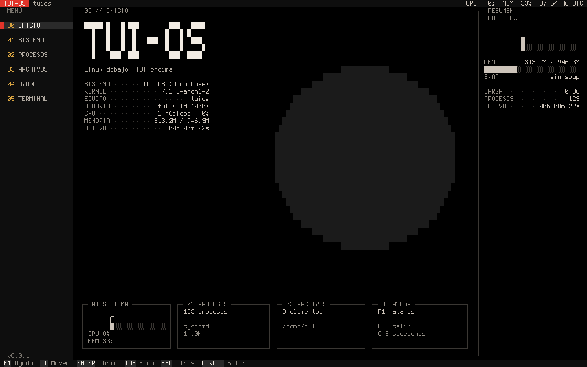
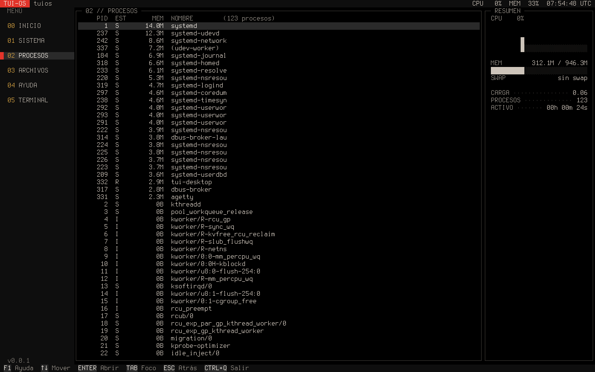

# TUI-OS

**¿Cómo sería un sistema operativo moderno si un terminal fuese su interfaz gráfica?**

TUI-OS es un experimento técnico y artístico: un sistema Linux cuyo escritorio entero
(menú, paneles, aplicaciones, atajos) se dibuja como una TUI, sin entorno gráfico
tradicional. Linux es la infraestructura; la interfaz y su identidad visual son lo que
se construye encima, en Rust.

> **Estado: experimental (Milestones 0-2 completos).** Arranca en QEMU/KVM hasta un
> escritorio TUI funcional. Todavía no hay shell integrada, compositor de ventanas ni
> pruebas en hardware real.

<p align="center">
  
</p>
<p align="center">
  
</p>

*Capturas reales de la consola de la máquina virtual (1280×800), no maquetas.*

## Qué hay hoy

- **Escritorio TUI** (`tui-desktop`): barra superior con CPU/memoria/hora, menú numerado,
  paneles con título `NN // SECCIÓN`, panel de resumen y barra de atajos. Secciones:
  Inicio, Sistema (CPU por núcleo, memoria, swap), Procesos (desde `/proc`),
  Archivos (navegador de carpetas) y Ayuda.
- **Runtime TUI** (`tui-core`, `tui-render`): celdas, buffers, superficies con daño,
  eventos de teclado/ratón/redimensionado y un renderer que emite solo lo que cambió.
- **Imagen arrancable**: rootfs Arch mínimo, disco UEFI (GPT + systemd-boot), arranque en
  QEMU/KVM y el escritorio lanzándose solo en la consola gráfica (tty1).
- **Herramientas de desarrollo**: scripts reproducibles, prueba de arranque automatizada
  y capturas de pantalla de la VM desde el monitor de QEMU.

## Base del sistema (importante)

TUI-OS **no es un sistema construido desde cero**: el target es un **Arch Linux mínimo**
(kernel `linux`, `glibc`, `systemd`, `pacman`, paquetes `base`). Lo propio es el userspace
TUI y la forma de construir la imagen. Las aplicaciones hablan con una capa de sistema
propia (`sys.rs`) y no con comandos de Arch, para poder cambiar la base más adelante.
Ver [ADR-0001](docs/adr/0001-base-arch-linux.md).

## Arquitectura

```
Aplicación → API TUI → Surface / Buffer → Compositor → Renderer → Terminal / Framebuffer
```

- La primitiva visual es la **celda** (carácter, color de texto, fondo, atributos).
  La interfaz trabaja en filas × columnas; el tamaño lo da siempre el terminal y el
  redimensionado es un evento normal.
- En terminales con truecolor se usan los colores RGB tal cual. En la **consola de Linux**
  (solo 16 colores) el renderer reprograma la paleta con la secuencia `OSC P`, de modo que
  los tonos del tema salen exactos (verificado midiendo píxeles de la VM).
- Los glifos se limitan a los que existen en la fuente de consola Terminus; un test
  de regresión lo comprueba.

Más detalle en [docs/architecture.md](docs/architecture.md).

## Estructura del repositorio

```
crates/
  tui-core/      Cell, Buffer, Surface, Rect y eventos de entrada
  tui-render/    renderer diferencial, Terminal (raw mode, pantalla alternativa), paleta
  tui-term/      terminal embebido: PTY (portable-pty) + intérprete VT (vt100) sobre celdas
  tui-desktop/   el escritorio: tema, capa de sistema (/proc), widgets y aplicaciones
config/
  packages.txt   paquetes del rootfs del target
  overlay/       ficheros que se copian sobre el rootfs (servicio de sesión, consola)
scripts/         bootstrap, build, test, rootfs, image, run, demo, screenshot, boot-test
docs/            arquitectura, roadmap, ADRs, issues con su evidencia, informes de milestone
```

## Requisitos

Anfitrión Arch Linux (x86_64) con: Rust/Cargo, QEMU con KVM, `edk2-ovmf`, Docker (el rootfs
se construye en un contenedor, sin tocar el sistema anfitrión) y `socat` + Python con Pillow
para las capturas. `./scripts/bootstrap` comprueba el entorno sin modificar nada.

## Uso

```sh
./scripts/bootstrap    # comprueba el anfitrión (solo lectura)
./scripts/test         # formato + clippy + tests
./scripts/rootfs       # construye build/rootfs.tar (Arch mínimo, en contenedor)
./scripts/image        # construye build/tuios.img (imagen UEFI)
./scripts/demo         # arranca TUI-OS en una ventana de QEMU
./scripts/boot-test    # arranque headless: exige el login por la consola serie
./scripts/screenshot @inicio 2 @procesos   # capturas PNG de la VM en build/shots/
```

Para ver el escritorio en tu propio terminal, sin QEMU: `cargo run -p tui-desktop`.

**Teclas:** `0-4` secciones · `↑ ↓` mover · `Enter`/`→` abrir · `Tab`/`Esc` foco ·
`F1` ayuda · `Backspace`/`←` subir de carpeta · `Q`/`Ctrl+Q` salir.
**Recuperación:** la consola serie (`ttyS0`) sigue siendo un login normal; `Ctrl+Alt+F2`
abre otra consola de texto y salir del escritorio con `Q` deja un login en tty1.

## Herramientas propias

El sistema incluirá herramientas desarrolladas por nosotros en vez de las habituales (fileTUI en lugar de yazi, y un monitor, un cliente de Docker y uno de Git propios). Catálogo y plan en [docs/apps.md](docs/apps.md).

## Roadmap

El trabajo se organiza en issues con criterios de aceptación y evidencia
([docs/roadmap.md](docs/roadmap.md)).

| Milestone | Contenido | Estado |
|---|---|---|
| M0 | Cimientos: repo, docs, workspace y scripts | Completo |
| M1 | Target arrancable: rootfs, imagen UEFI, QEMU, prueba de arranque | Completo |
| M2 | Runtime TUI, entrada, escritorio y arranque en QEMU | Completo |
| M3 | Compositor: ventanas, z-order, foco, recorte, mosaico (regiones sucias, M3-04, si se mide) | Completo |
| M4 | Sesión de usuario sin root, recuperación en tty1 | Completo |
| M5 | Terminal embebido (PTY + VT); M5-01 hecho, grafemas y Unicode pendientes | En curso |
| M6 | Comandos `tui …` y frontend de paquetes sobre pacman | Pendiente |

## Limitaciones conocidas

- **Solo probado en QEMU/KVM**; no hay pruebas en hardware real.
- La contraseña de root es `tuios` y el escritorio corre como root: **solo para desarrollo**.
- Sin ratón en la consola de Linux (no hay `gpm`); funciona en emuladores de terminal.
- Sin ancho Unicode: un carácter ocupa una celda (no hay kanji ni emoji).
- Sin shell integrada todavía: el escritorio no ejecuta comandos.

## Estilo visual y créditos

La estética de TUI-OS **copia el lenguaje visual de [Ryoku Arch](https://ryoku.dev)**, un
proyecto que ya existe (según su documentación, un escritorio sobre Arch Linux con Hyprland
y Quickshell). TUI-OS lo adapta a un terminal y **no es un proyecto oficial de Ryoku ni está
afiliado a él**; la identidad visual de Ryoku pertenece a sus autores.

Lo adaptado, en términos de TUI:

- **Papel y tinta**: negro puro y texto hueso cálido, casi monocromo, con una rampa corta de
  tonos para las superficies. Sin degradados, sin neones y sin sombras: la jerarquía se
  marca con tono y borde fino.
- **Acentos contados**: bermellón solo para la marca y el foco, oro para la numeración.
- **Ficha técnica**: títulos `NN // SECCIÓN`, filas de datos con línea guía
  (`KERNEL ····· 7.2.8-arch1-2`) y etiquetas en mayúsculas.
- **Disco-sol plano** como motivo recurrente, en una sola superficie tonal.

| Token | Color | Uso |
|---|---|---|
| `PAPER` | `#000000` | fondo |
| `INK` | `#cdc4ba` | texto |
| `INK_DIM` / `MUTED` / `FAINT` | `#b0a9a0` / `#958f87` / `#7a756e` | texto secundario |
| `RAISED` / `CONTAINER` / `HIGH` | `#0e0e0e` / `#1b1b1b` / `#2a2a2a` | superficies |
| `VERMILION` | `#e2342a` | marca |
| `GOLD` | `#d9a441` | numeración |
| `ACTIVE` | `#e0563b` | borde con foco |
| `LINE` | `#3a3733` | borde sin foco |

Los tokens viven en [`crates/tui-desktop/src/theme.rs`](crates/tui-desktop/src/theme.rs).

## Licencia

Pendiente de decidir.
